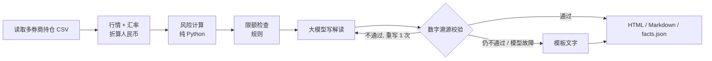
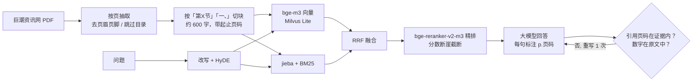
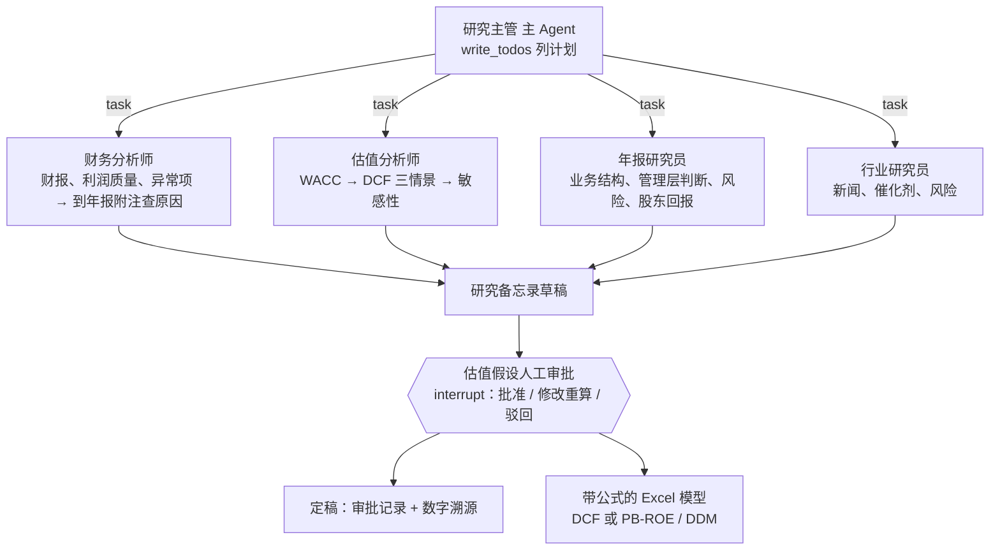
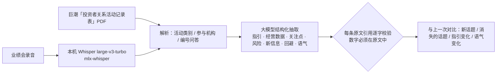

# Cyron Veritas · AI 投研与风控助手

> *Veritas*（拉丁语：真实）——每一个数字都由代码计算，每一句结论都可以追溯。

**组合风控日报（LangGraph）· 研究 Agent（DeepAgents，A 股 / 港股 / 美股，DCF 与 PB-ROE / DDM）· 估值假设人工审批（LangGraph interrupt）· 年报 RAG 问答 · 业绩会纪要（含录音转写）· MCP Server · Web 界面（FastAPI + Vue 3）**。
模拟买方研究员和风控岗的日常工作流。

核心原则：**数字全部由代码计算，大模型只负责规划、检索、解读和写作；每份输出都做溯源校验**（数字能在计算结果或年报原文中找到、引用的页码在证据范围内）。
这也是金融机构真正敢用 AI 的方式：结论可复核、过程可追溯、不给投资建议。

| 组合风控 | 研究备忘录 | 估值假设审批 |
|---|---|---|
|  |  |  |
| **年报问答** | **业绩会纪要** | |
|  |  | |

## 模块

### 1. 组合风控日报（LangGraph 固定流程）



| 计算内容 | 方法 |
|---|---|
| 敞口 | 行业、市场、币种；集中度（前一 / 前五、HHI、有效持仓数） |
| 波动与相关性 | 年化波动率、Beta（沪深300）、相关性最高的持仓对 |
| VaR / CVaR | 历史模拟法（95% / 99%）、参数法（正态），按「当前持仓回放」近 500 个交易日 |
| 风险贡献 | 各持仓占组合波动比例 w·(Σw) / w'Σw |
| 压力测试 | 历史情景（2020 新冠、2022 港股中概、2024 年初 A 股）+ 假设情景（市场、汇率、板块冲击） |
| 模型回测 | 滚动 250 天 VaR 回测 + Kupiec 失败比例检验 |
| 限额 | `config/limits.yaml`：单一持仓、前五大、行业、市场、外币、VaR、回撤、现金下限；超限时列出全部超限标的 |

### 2. 年报 RAG（巨潮资讯网年报 → 带页码问答）



- **切块**：PDF 硬换行只在「正文被折行」时拼接（上一行接近满行且不以句末标点结尾），表格单元格保留换行，避免两列数字粘成一个数。
- **存储**：Milvus Lite（本地单文件，不需要 Docker）+ 切块 JSON；同一份 PDF（sha256 + 解析器版本）不重复入库。
- **校验**：回答里引用的页码必须落在检索到的证据范围内；回答里的数字必须出现在证据原文里；不通过带着错误重写一次。

**评测**（[eval/annual_report_qa.json](eval/annual_report_qa.json)：美的集团、宁德时代、招商银行 2025 年报，40 题，分数字类 / 语义类；
答案页由原文锚点自动定位；[完整结果](eval/results.md)）

| 检索方案 | Hit@1 | Hit@3 | Hit@5 | MRR | Hit@5·招商银行 | Hit@5·语义题 |
|---|---|---|---|---|---|---|
| 仅向量（bge-m3） | 50% | 52% | 68% | 0.543 | 20% | 78% |
| 仅 BM25 | 35% | 75% | 90% | 0.576 | 80% | 89% |
| 混合（RRF） | 50% | 78% | 80% | 0.630 | 60% | 78% |
| **混合 + 重排** | **62%** | **88%** | **95%** | **0.747** | **90%** | **100%** |
| 改写 + HyDE + 混合 + 重排 | 62% | 88% | 92% | 0.736 | 80% | 100% |

端到端：**答案正确率 100%（40/40），引用与数字校验通过率 100%**，平均 6.2 秒/题。

两点发现（如实记录）：
- **银行年报几乎全是数字表格，纯向量检索在招行上 Hit@5 只有 20%**（「不良贷款率 0.94%」这类内容在向量空间里区分度很低），BM25 的精确匹配是关键，混合 + 重排后 90%。
- 问题改写 + HyDE 没有带来提升（Hit@5 反而 92% vs 95%，多花约 1.4 秒/题）；当前默认仍保留，后续按题型开关。

### 3. 研究 Agent（DeepAgents）+ 估值假设人工审批



- **工具全部只读、全部是代码计算**：财报取数与比率、市场数据与 Beta、CAPM WACC、DCF（FCFF 法）、PB-ROE / DDM、年报检索、新闻搜索；每次调用记进证据账本，返回证据编号，备忘录引用编号和年报页码。
- **三个市场**：A 股（东方财富三表）、港股（「经营溢利」作 EBIT；报表币种按「市值 ÷ 市净率 ÷ 每股净资产」反推——腾讯是人民币报表、港元股价）、美股（美元报告公司）；
  无风险利率 A 股用中国 10 年国债，港股 / 美股用美国 10 年国债；每股价值换算成股价币种。港美股暂无年报检索。
- **金融企业**（A 股银行、保险、券商）不用 DCF，改用 **PB-ROE**（合理 P/B =（ROE − g）/（Ke − g），普通股净资产扣除优先股和永续债）和**两阶段 DDM**；
  工具同时输出「按现价倒推的市场隐含股权成本」，和模型 Ke 差距大时 Agent 必须解释分歧来源。
- **口径**：营运资本只用经营性科目（应收、票据、存货、合同资产 − 应付、合同负债、薪酬、税费）；计入其他科目的定期存款 / 理财不自动算现金，
  估值分析师到年报附注里核实后才能填 `extra_cash`，且必须写明科目、金额和页码。
- **估值假设人工审批**：外层 LangGraph 流程「研究 → 审批（`interrupt`）→ 定稿」。Agent 跑完后暂停，把基准假设、依据和市场对照交给分析师：
  批准 / 修改后重算 / 驳回；修改会用新假设重新计算并记入证据账本，审批人、意见和前后对比写进备忘录，Excel 按审批后的假设生成，驳回则不出 Excel。
  （审批放在外层图而不是 DeepAgents 内部：子 Agent 在工具调用里嵌套运行，在那里暂停恢复不稳定。）
- **Excel 模型是真公式**（蓝色输入 / 黑色公式）：DCF 模型和 PB-ROE / DDM 模型都是；改假设页，估值和敏感性自动重算；测试里用 `formulas` 库重算工作簿，和 Python 引擎一致到小数点后 9 位。
- **估值前先做利润质量审查**：杜邦三步 / 五步、Piotroski F 分（9 项）、Altman Z（制造业原版与 Z''）、Beneish M 分（8 变量）、应计比率，
  由代码按规则给出 **A–D 利润可信度评级**（Beneish > −1.78 扣 2 级；应计比率 > 10%、经营现金流 / 净利 < 0.8、Piotroski ≤ 3 各扣 1 级）；
  C 级结论只能「观望」，D 级不能给正面结论。评级不交给大模型判断。
- **反向 DCF（预期差）**：其他假设不变，求出让每股价值等于现价的收入增速，和我们的假设、历史增速放进同一张「预期差表」。
- **备忘录九章结构**（参考 [equity-research-skill](https://github.com/rollingSirius/equity-research-skill) 的机构研究框架）：一页摘要（结论框 + 预期差表）、
  公司与业务、竞争格局、管理层与资本配置、财务分析与利润质量审查、估值、催化剂与风险、**反方观点与事前验尸**、待核实问题；章节缺失时如实标注。
- **护栏**：模型调用、工具调用、派活次数都有上限；假设不合理（如永续增长率 ≥ WACC、g ≥ ROE）工具直接拒绝；
  模型推理加锁（MPS 不支持多线程同时提交计算，多个子 Agent 并行检索曾导致 Metal 断言崩溃）。
- **为什么风控用 LangGraph、研究用 DeepAgents**：日报步骤固定、要求稳定可复核 → 固定流程；研究是开放任务（查什么、查几轮、发现异常要不要追问）→ 让 Agent 自己列计划、派子 Agent。

### 4. 业绩会纪要（投资者关系记录 / 录音 → 指引、回避的问题、环比变化）



- **研究员最需要的不是「这次说了什么」，而是「哪里变了、哪些问题没正面回答」**：抽取结果单列「回避或未正面回答」，对比单列「指引变化」。
- **每条结论带原文引用**：引用去掉空白和标点后必须是原文子串，否则在纪要里标 ⚠️；概览和数值里的数字必须出现在原文中。
- **实测**（美的集团 2026-09-15 业绩说明会，18 组网上问答，对比 2026-07-29 路演）：69 条引用全部通过、63 个数字全部可溯源、22 条对比变化引用全部通过；
  纪要指出「B 端增速放缓原因、权益工具公允价值变动 26.77 亿元的来源、库卡分拆上市」等问题管理层均未正面回答。
- **录音**：本机 mlx-whisper（30 秒音频约 9 秒转写，「百分之十二」自动规范为「12%」）；没有说话人分离，问答由大模型按语义切分（下一步：FunASR 说话人分离、SenseVoice 支持粤语）。

### 5. MCP Server（Claude Desktop / Cursor 直接调用）

`uv run veritas mcp`（stdio）暴露 10 个工具：`portfolio_risk`、`company_financials`、`market_snapshot`、`dcf_valuation`、
`financial_institution_valuation`、`annual_report_search`、`annual_report_qa`、`ingest_annual_report`、`investor_relations_records`、`earnings_call_summary`。
除年报入库外全部标注为只读；数字仍由代码计算，客户端的大模型只负责提问和组织回答。Claude Desktop 配置：

```json
{"mcpServers": {"cyron-veritas": {"command": "uv", "args": ["--directory", "/path/to/cyron-veritas", "run", "veritas", "mcp"]}}}
```

### 6. Web 界面（FastAPI + Vue 3）

四个页面：组合风控（选持仓 → 生成日报，显示流程与校验结果）、研究备忘录（实时显示 Agent 在做什么、估值假设审批表单、下载 Excel 模型）、
年报问答（入库新年报、流式回答、点页码看原文 / 打开 PDF 对应页）、业绩会纪要（选交流记录或上传录音，生成纪要并与上一次对比）。长任务在后台线程运行，前端通过 SSE 订阅进度。

## 与业界开源库交叉验证

自研的估值、风险和利润质量计算，用同样的输入和成熟开源库逐项对答案（`tests/test_cross_validation.py`，10 项全部通过）：

| 自研实现 | 对照库 | 结果 |
|---|---|---|
| DCF（FCFF） | [FinanceToolkit](https://github.com/JerBouma/FinanceToolkit) `get_intrinsic_value` | 一致（相对误差 < 1e-9） |
| 两阶段 DDM | FinanceToolkit `get_two_stage_dividend_discount_model` | 一致 |
| PB-ROE | FinanceToolkit 戈登增长模型 | 一致（约定差异：PB-ROE 用当期净资产 × ROE 作下一年利润，相差 (1+g)，测试中写明） |
| CAPM 股权成本 | FinanceToolkit `get_capital_asset_pricing_model` | 一致 |
| 杜邦三步 / 五步、Altman Z、Piotroski 各项 | FinanceToolkit `dupont_model` / `altman_model` / `piotroski_model` | 一致 |
| VaR、CVaR、最大回撤、年化波动率、Beta | [empyrical](https://github.com/stefan-jansen/empyrical-reloaded) | 一致 |
| 反向 DCF | 自洽性：用某增速算出价格，再反推回同一增速 | 一致 |

## 样例结果（2026-10-20，真实模型 DeepSeek）

**风控日报**（示例持仓，4 个券商账户、8 只股票 + 现金）：总市值 215.8 万元，1 日 95% VaR 1.53%（约 3.3 万元）；
3 项超限（英伟达、苹果、招商银行单一持仓 > 15%，前五大 77.4%，外币资产 65.2%）；VaR 回测 250 天突破 10 次（理论 12.5 次），Kupiec p = 0.45；
解读中的数字全部可溯源。→ [HTML 报告](docs/samples/risk_report.html)

**美的集团（000333）研究备忘录**：111 秒，4 个子 Agent，约 14 万 token；DCF 三情景每股 110.0 / 157.0 / 180.7 元（现价 86.54 元）；
备忘录 756 个数字中 740 个可在证据账本中找到（97.9%，未溯源的多为模型自行计算的差值）。
财务分析师发现 2025 年营运资本占收入比从 −9.6% 跳到 +8.1%，**自己到年报附注里查到原因**：
一年内到期的固定收益类产品从 486 亿元增至 1,554 亿元（年报 p.208-209，计入流动资产但不是货币资金），并如实注明「年报中未找到整体说明」；
同时指出终值占 EV 80% 以上、近两年周线 Beta 的 R² 仅 0.003（改用 5 年月线），结论对 WACC 和永续增长率高度敏感。
→ [备忘录](docs/samples/000333_memo.md) · [Excel 模型](docs/samples/000333_DCF模型.xlsx)

**招商银行（600036，PB-ROE / DDM + 人工审批）**：Agent 建议长期 ROE 14.5%（近 3 年均值 15.28%，但 2022→2025 从 17.7% 降到 14.0%，下调）、
Ke 用 CAPM 6.45%，基准每股 136.31 元；审批卡片显示当前 P/B 0.99、模型合理 P/B 3.33、**按现价倒推的市场隐含 Ke 14.6%**。
分析师把 Ke 改为 10% 后重算：PB-ROE 71.36 元、DDM 57.86 元，平均 **64.61 元**；审批记录写入备忘录第七节。
→ [备忘录](docs/samples/600036_memo.md) · [Excel 模型](docs/samples/600036_估值模型.xlsx)

**腾讯控股（00700，港股）**：识别出人民币报表 / 港元股价（汇率 1.1677），DCF 基准每股 304 港元（现价 417.8 港元）；
Agent 抓住的关键变量是 AI 资本开支（单季同比 +176%，自由现金流转负）。

## 运行

```bash
uv sync
cp .env.example .env              # 填 LLM_API_KEY（DeepSeek 或任何 OpenAI 兼容接口），新闻搜索需要 TAVILY_API_KEY
cd frontend && npm install && npx vite build && cd ..
uv run veritas serve              # Web 界面 http://127.0.0.1:8100

uv run veritas risk               # 命令行生成风控日报（默认 portfolio/sample_portfolio.csv；真实持仓用 portfolio/private_*.csv，已 gitignore）
uv run veritas ingest 000333 2025 # 下载并入库年报（约 1 分钟）
uv run veritas research 000333    # 研究 Agent（也支持 600036 银行、00700 港股、AAPL 美股）
uv run veritas research 600036 --review   # 估值假设在终端里人工审批
uv run veritas calls 000333       # 最新一次投资者交流纪要，并与上一次对比
uv run veritas transcribe call.m4a --company 某公司   # 录音 → 纪要
uv run veritas mcp                # MCP Server（stdio）
uv run python -m cyron_veritas.rag.evaluate --qa   # 年报问答评测
uv run pytest -q                  # 48 个测试（含与 FinanceToolkit / empyrical 的交叉验证）
```

向量和重排模型默认读 `~/models/bge-m3`、`~/models/bge-reranker-v2-m3`，不存在则从 HuggingFace 下载（`EMBED_MODEL` / `RERANK_MODEL` 可覆盖）。
在 Apple Silicon 上自动用 MPS。

## 目录

```
src/cyron_veritas/
  data/        market.py（行情、汇率、国债收益率，按天缓存）  financials.py（A 股三表 → 统一口径）
  risk/        metrics.py（纯函数）  portfolio.py  limits.py  report_graph.py（LangGraph）
  valuation/   dcf.py（FCFF、WACC、敏感性、反向 DCF）  fin.py（PB-ROE、DDM）  quality.py（杜邦、Piotroski、Altman、Beneish、A–D 评级）  excel.py
  rag/         filings.py（下载、解析、切块）  index.py（Milvus Lite + BM25 + 重排）  qa.py（带页码问答与校验）  evaluate.py
  research/    tools.py（工具 + 证据账本）  agent.py（DeepAgents 主 / 子 Agent + 外层审批流程）
  calls/       source.py（记录表解析、Whisper 转写）  analyze.py（抽取、引用校验、对比）  run.py
  mcp_server.py  MCP Server（10 个工具）
  web/         server.py（FastAPI、后台任务、SSE）
  report/      charts.py  render.py  templates/
  verify.py    数字溯源与措辞检查
frontend/      Vue 3 + Vite（风控 / 研究 / 年报问答）
eval/          年报问答评测集与结果
```

## 数据与口径

数据来自 [akshare](https://github.com/akfamily/akshare)（东方财富、新浪财经、中国银行外汇中间价、国债收益率）和巨潮资讯网年报，均为公开数据。
EBIT = 利润总额 + 利息费用 − 利息收入；有息负债含租赁负债；基期营运资本按假设比例标准化。口径细节见各模块顶部注释。

## 已知局限

- 研究备忘录是长文本，仍用「数字能在证据账本中找到」做溯源（九章结构下约 94%：预期差和事前验尸里 Agent 自己做了加减运算），
  没有像风控日报那样做到结构化引用；溯源也检查不出「算式写错」（实测出现过一次括号里的加减式与结果不符）。
- 类现金资产的计入：Agent 会到年报附注核实，但实测仍可能把全部候选金额（而非附注确认的部分）填进 extra_cash，需要人工审批把关。
- 港股 / 美股：没有年报原文检索；美股只支持美元报告公司（中概 ADR 的人民币报表和 ADS 比例未处理）；港美股金融企业暂不支持。
- 银行估值没有用到不良率、拨备覆盖率等资产质量指标的量化调整（Agent 从年报中引用，但不进入模型）；CAPM 在当前低利率下给出的 Ke 偏低，需要人工审批把关。
- 审批流程的检查点存在内存（MemorySaver），服务重启后未完成的审批会丢失；生产环境应换成 SQLite / Postgres checkpointer。
- 年报评测集 40 题、3 份年报，规模仍小。

## 免责声明

本项目仅用于学习和研究，不构成任何投资建议。示例持仓为虚构。
