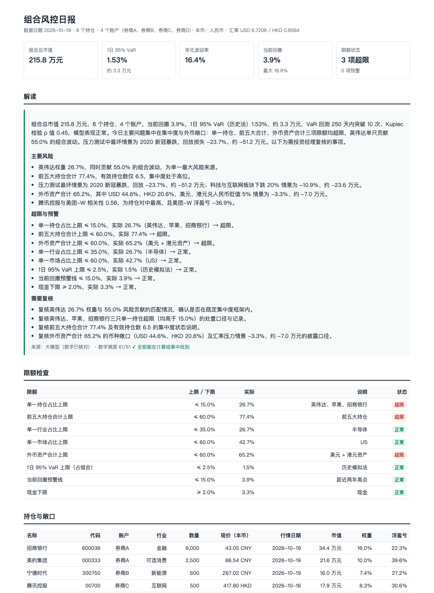
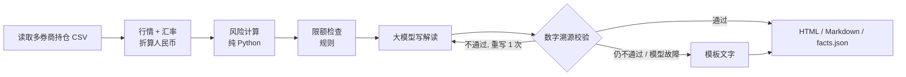
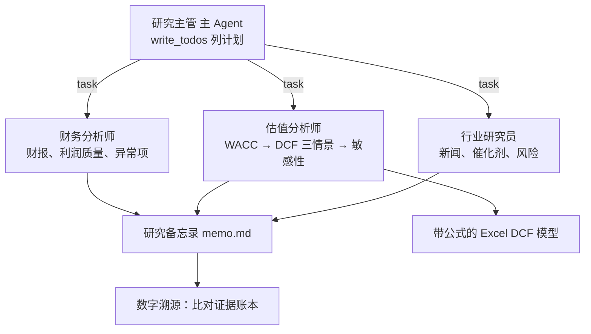

# analyst-desk · AI 投研助手

**组合风控日报（LangGraph）+ DCF 研究 Agent（DeepAgents）**。模拟买方研究员和风控岗的日常工作流。

核心原则：**数字全部由代码计算，大模型只负责规划、检索、解读和写作；每份输出都做数字溯源校验。**
这也是金融机构真正敢用 AI 的方式：结论可复核、过程可追溯、不给投资建议。



## 两个模块

### 1. 组合风控日报（LangGraph 固定流程）



| 计算内容 | 方法 |
|---|---|
| 敞口 | 行业、市场、币种；集中度（前一 / 前五、HHI、有效持仓数） |
| 波动与相关性 | 年化波动率、Beta（沪深300）、相关性最高的持仓对 |
| VaR / CVaR | 历史模拟法（95% / 99%）、参数法（正态），按「当前持仓回放」近 500 个交易日 |
| 风险贡献 | 各持仓占组合波动比例 w·(Σw) / w'Σw |
| 回撤 | 最大回撤、当前回撤 |
| 压力测试 | 历史情景（2020 新冠、2022 港股中概、2024 年初 A 股）+ 假设情景（市场、汇率、板块冲击） |
| 模型回测 | 滚动 250 天 VaR 回测 + Kupiec 失败比例检验 |
| 限额 | `config/limits.yaml`：单一持仓、前五大、行业、市场、外币、VaR、回撤、现金下限；状态分正常 / 预警 / 超限 |

**数字溯源**：代码先把结果格式化成「事实表」，大模型只能引用这张表；输出后抽取全部数字逐个比对，
找不到出处或出现「买入 / 减仓 / 目标价」等措辞就退回重写，再不过就改用模板，保证日报每天都能生成。

### 2. DCF 研究 Agent（DeepAgents）



- **工具全部只读、全部是代码计算**：财报取数与比率、市场数据与 Beta、CAPM WACC、DCF（FCFF 法）、新闻搜索；
  每次调用记进证据账本，返回证据编号（E1、E2…），备忘录引用编号。
- **Excel 模型是真公式**（蓝色输入 / 黑色公式，投行惯例）：改假设页，预测、估值、敏感性自动重算；
  测试里用 `formulas` 库重算工作簿，确认和 Python 引擎结果一致到小数点后 9 位。
- **护栏**：模型调用、工具调用、派活次数都有上限；DCF 假设不合理（如永续增长率 ≥ WACC）工具直接拒绝；
  金融企业（银行、保险）不适用 FCFF 法，直接提示改用 PB-ROE / DDM。
- **为什么风控用 LangGraph、研究用 DeepAgents**：日报步骤固定、要求稳定可复核 → 固定流程；
  研究是开放任务（查什么、查几轮、发现异常要不要追问）→ 让 Agent 自己列计划、派子 Agent。

## 样例结果（2026-10-20，真实模型 DeepSeek）

**风控日报**（示例持仓，4 个券商账户、8 只股票 + 现金）：
总市值 215.8 万元，1 日 95% VaR 1.53%（约 3.3 万元）；3 项超限（英伟达、苹果、招商银行单一持仓 > 15%，前五大 77.4%，外币资产 65.2%）；
VaR 回测 250 天突破 10 次（理论 12.5 次），Kupiec p = 0.45；解读中 61 个数字全部可溯源。
→ [HTML 报告](docs/samples/risk_report.html) · [Markdown](docs/samples/risk_report.md)

**美的集团（000333）研究备忘录**：47 秒，3 个子 Agent 并行，约 6.9 万 token；
DCF 三情景每股 110.6 / 151.7 / 191.4 元（现价 86.54 元）；备忘录 460 个数字中 459 个可在证据账本中找到。
Agent 自己发现 2025 年营运资本占收入比从 −9.6% 跳到 +8.1%（美的大额定期存款不在货币资金科目），改用近 3 年均值并列为待核实问题；
同时指出终值占 EV 83%、近两年周线 Beta 的 R² 仅 0.003（改用 5 年月线），结论对 WACC 和永续增长率高度敏感。
→ [备忘录](docs/samples/000333_memo.md) · [Excel 模型](docs/samples/000333_DCF模型.xlsx)

## 运行

```bash
uv sync
cp .env.example .env        # 填 LLM_API_KEY（DeepSeek 或任何 OpenAI 兼容接口），新闻搜索需要 TAVILY_API_KEY
uv run desk risk            # 风控日报（默认 portfolio/sample_portfolio.csv）
uv run desk risk --portfolio portfolio/private_mine.csv   # private_* 已在 .gitignore 中
uv run desk research 000333 # DCF 研究 Agent（A 股非金融企业）
uv run pytest -q            # 18 个测试
```

持仓 CSV 列：`account,ticker,name,market,currency,sector,quantity,cost`；market 为 A / HK / US / CASH。同一标的在多个账户的持仓会自动合并。

## 目录

```
src/analyst_desk/
  data/        market.py（行情、汇率、国债收益率，按天缓存）  financials.py（A 股三表 → 统一口径）
  risk/        metrics.py（纯函数）  portfolio.py（估值、敞口、压力测试）  limits.py  report_graph.py（LangGraph）
  valuation/   dcf.py（FCFF、WACC、敏感性）  excel.py（公式模型导出）
  research/    tools.py（工具 + 证据账本）  agent.py（DeepAgents 主 / 子 Agent）
  report/      charts.py  render.py  templates/
  verify.py    数字溯源与措辞检查
```

## 数据与口径

数据来自 [akshare](https://github.com/akfamily/akshare)（东方财富、新浪财经、中国银行外汇中间价、国债收益率），均为公开数据。
EBIT = 利润总额 + 利息费用 − 利息收入；有息负债含租赁负债；基期营运资本按假设比例标准化（避免单年科目重分类造成跳变）。
口径细节见 `data/financials.py` 和 `valuation/dcf.py` 顶部注释。

## 已知局限与下一步

- 数字溯源只核对「数字有出处」，还不核对「数字和描述的对象匹配」（下一步：按事实表的键做结构化引用）。
- 现金口径未包含计入其他流动资产的定期存款，现金充裕的公司估值会偏保守 / 营运资本会失真（Agent 会提示，但未自动调整）。
- 研究 Agent 目前只支持 A 股非金融企业；港美股财报、金融企业估值（PB-ROE、DDM）在计划中。
- 计划：年报原文 RAG（管理层讨论、风险因素，答案附页码）、人工审批估值假设（DeepAgents interrupt）、Web 界面、研究备忘录评测集。

## 免责声明

本项目仅用于学习和研究，不构成任何投资建议。示例持仓为虚构。
