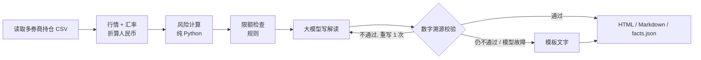
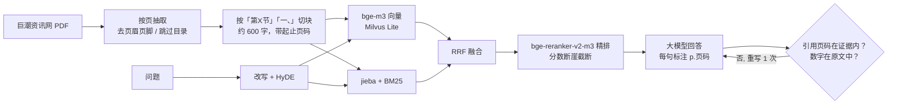
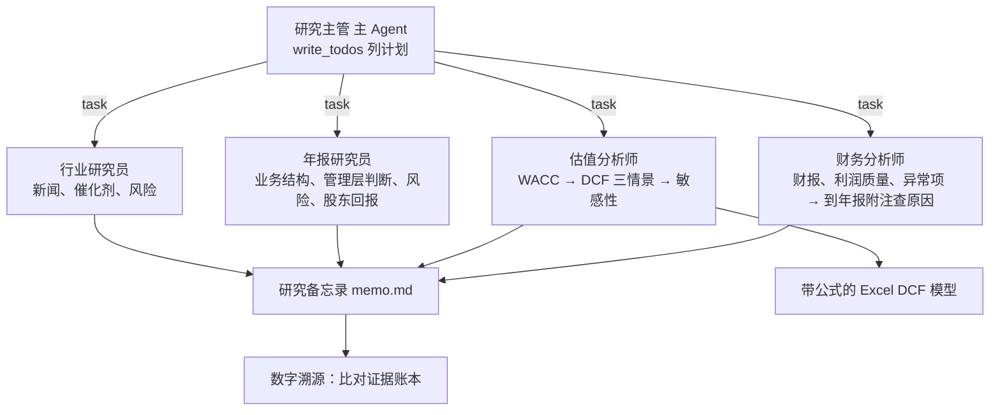

# Cyron Veritas · AI 投研与风控助手

> *Veritas*（拉丁语：真实）——每一个数字都由代码计算，每一句结论都可以追溯。

**组合风控日报（LangGraph）· DCF 研究 Agent（DeepAgents）· 年报 RAG 问答 · Web 界面（FastAPI + Vue 3）**。
模拟买方研究员和风控岗的日常工作流。

核心原则：**数字全部由代码计算，大模型只负责规划、检索、解读和写作；每份输出都做溯源校验**（数字能在计算结果或年报原文中找到、引用的页码在证据范围内）。
这也是金融机构真正敢用 AI 的方式：结论可复核、过程可追溯、不给投资建议。

| 组合风控 | 研究备忘录 | 年报问答 |
|---|---|---|
|  |  |  |

## 四个模块

### 1. 组合风控日报（LangGraph 固定流程）



| 计算内容 | 方法 |
|---|---|
| 敞口 | 行业、市场、币种；集中度（前一 / 前五、HHI、有效持仓数） |
| 波动与相关性 | 年化波动率、Beta（沪深300）、相关性最高的持仓对 |
| VaR / CVaR | 历史模拟法（95% / 99%）、参数法（正态），按「当前持仓回放」近 500 个交易日 |
| 风险贡献 | 各持仓占组合波动比例 w·(Σw) / w'Σw |
| 压力测试 | 历史情景（2020 新冠、2022 港股中概、2024 年初 A 股）+ 假设情景（市场、汇率、板块冲击） |
| 模型回测 | 滚动 250 天 VaR 回测 + Kupiec 失败比例检验 |
| 限额 | `config/limits.yaml`：单一持仓、前五大、行业、市场、外币、VaR、回撤、现金下限；超限时列出全部超限标的 |

### 2. 年报 RAG（巨潮资讯网年报 → 带页码问答）



- **切块**：PDF 硬换行只在「正文被折行」时拼接（上一行接近满行且不以句末标点结尾），表格单元格保留换行，避免两列数字粘成一个数。
- **存储**：Milvus Lite（本地单文件，不需要 Docker）+ 切块 JSON；同一份 PDF（sha256 + 解析器版本）不重复入库。
- **校验**：回答里引用的页码必须落在检索到的证据范围内；回答里的数字必须出现在证据原文里；不通过带着错误重写一次。

**评测**（[eval/annual_report_qa.json](eval/annual_report_qa.json)：美的集团 2025 年报，20 道人工标注答案页的问题；[完整结果](eval/results.md)）

| 检索方案 | Hit@1 | Hit@3 | Hit@5 | MRR |
|---|---|---|---|---|
| 仅向量（bge-m3） | 55% | 60% | 80% | 0.612 |
| 仅 BM25 | 20% | 65% | 90% | 0.475 |
| 混合（RRF） | 55% | 85% | 85% | 0.683 |
| **混合 + 重排** | **65%** | **95%** | **95%** | **0.758** |
| 改写 + HyDE + 混合 + 重排 | 65% | 95% | 95% | 0.758 |

端到端：**答案正确率 100%（20/20），引用与数字校验通过率 100%**，平均 7.5 秒/题。
如实说明：在这 20 题上，问题改写 + HyDE 没有带来额外提升（多花约 1.5 秒/题）；题目以数字类为主，BM25 已经能覆盖科目名和关键词，需要更多语义类问题再评估。

### 3. DCF 研究 Agent（DeepAgents）



- **工具全部只读、全部是代码计算**：财报取数与比率、市场数据与 Beta、CAPM WACC、DCF（FCFF 法）、年报检索、新闻搜索；每次调用记进证据账本，返回证据编号，备忘录引用编号和年报页码。
- **Excel 模型是真公式**（蓝色输入 / 黑色公式）：改假设页，预测、估值、敏感性自动重算；测试里用 `formulas` 库重算工作簿，和 Python 引擎一致到小数点后 9 位。
- **护栏**：模型调用、工具调用、派活次数都有上限；DCF 假设不合理（如永续增长率 ≥ WACC）工具直接拒绝；金融企业不适用 FCFF 法，直接提示改用 PB-ROE / DDM；
  模型推理加锁（MPS 不支持多线程同时提交计算，多个子 Agent 并行检索曾导致 Metal 断言崩溃）。
- **为什么风控用 LangGraph、研究用 DeepAgents**：日报步骤固定、要求稳定可复核 → 固定流程；研究是开放任务（查什么、查几轮、发现异常要不要追问）→ 让 Agent 自己列计划、派子 Agent。

### 4. Web 界面（FastAPI + Vue 3）

三个页面：组合风控（选持仓 → 生成日报，显示流程与校验结果）、研究备忘录（实时显示 Agent 在做什么、下载 Excel 模型）、
年报问答（入库新年报、流式回答、点页码看原文 / 打开 PDF 对应页）。长任务在后台线程运行，前端通过 SSE 订阅进度。

## 样例结果（2026-10-20，真实模型 DeepSeek）

**风控日报**（示例持仓，4 个券商账户、8 只股票 + 现金）：总市值 215.8 万元，1 日 95% VaR 1.53%（约 3.3 万元）；
3 项超限（英伟达、苹果、招商银行单一持仓 > 15%，前五大 77.4%，外币资产 65.2%）；VaR 回测 250 天突破 10 次（理论 12.5 次），Kupiec p = 0.45；
解读中的数字全部可溯源。→ [HTML 报告](docs/samples/risk_report.html)

**美的集团（000333）研究备忘录**：111 秒，4 个子 Agent，约 14 万 token；DCF 三情景每股 110.0 / 157.0 / 180.7 元（现价 86.54 元）；
备忘录 756 个数字中 740 个可在证据账本中找到（97.9%，未溯源的多为模型自行计算的差值）。
财务分析师发现 2025 年营运资本占收入比从 −9.6% 跳到 +8.1%，**自己到年报附注里查到原因**：
一年内到期的固定收益类产品从 486 亿元增至 1,554 亿元（年报 p.208-209，计入流动资产但不是货币资金），并如实注明「年报中未找到整体说明」；
同时指出终值占 EV 80% 以上、近两年周线 Beta 的 R² 仅 0.003（改用 5 年月线），结论对 WACC 和永续增长率高度敏感。
→ [备忘录](docs/samples/000333_memo.md) · [Excel 模型](docs/samples/000333_DCF模型.xlsx)

## 运行

```bash
uv sync
cp .env.example .env              # 填 LLM_API_KEY（DeepSeek 或任何 OpenAI 兼容接口），新闻搜索需要 TAVILY_API_KEY
cd frontend && npm install && npx vite build && cd ..
uv run veritas serve              # Web 界面 http://127.0.0.1:8100

uv run veritas risk               # 命令行生成风控日报（默认 portfolio/sample_portfolio.csv；真实持仓用 portfolio/private_*.csv，已 gitignore）
uv run veritas ingest 000333 2025 # 下载并入库年报（约 1 分钟）
uv run veritas research 000333    # DCF 研究 Agent（A 股非金融企业）
uv run python -m cyron_veritas.rag.evaluate --qa   # 年报问答评测
uv run pytest -q                  # 25 个测试
```

向量和重排模型默认读 `~/models/bge-m3`、`~/models/bge-reranker-v2-m3`，不存在则从 HuggingFace 下载（`EMBED_MODEL` / `RERANK_MODEL` 可覆盖）。
在 Apple Silicon 上自动用 MPS。

## 目录

```
src/cyron_veritas/
  data/        market.py（行情、汇率、国债收益率，按天缓存）  financials.py（A 股三表 → 统一口径）
  risk/        metrics.py（纯函数）  portfolio.py  limits.py  report_graph.py（LangGraph）
  valuation/   dcf.py（FCFF、WACC、敏感性）  excel.py（公式模型导出）
  rag/         filings.py（下载、解析、切块）  index.py（Milvus Lite + BM25 + 重排）  qa.py（带页码问答与校验）  evaluate.py
  research/    tools.py（工具 + 证据账本）  agent.py（DeepAgents 主 / 子 Agent）
  web/         server.py（FastAPI、后台任务、SSE）
  report/      charts.py  render.py  templates/
  verify.py    数字溯源与措辞检查
frontend/      Vue 3 + Vite（风控 / 研究 / 年报问答）
eval/          年报问答评测集与结果
```

## 数据与口径

数据来自 [akshare](https://github.com/akfamily/akshare)（东方财富、新浪财经、中国银行外汇中间价、国债收益率）和巨潮资讯网年报，均为公开数据。
EBIT = 利润总额 + 利息费用 − 利息收入；有息负债含租赁负债；基期营运资本按假设比例标准化。口径细节见各模块顶部注释。

## 已知局限与下一步

- 数字溯源只核对「数字有出处」，还不核对「数字和描述的对象匹配」（下一步：按事实表的键做结构化引用）。
- 现金口径未包含计入其他流动资产 / 一年内到期非流动资产的定期存款和理财，现金充裕的公司估值偏保守（Agent 会从年报中指出，但未自动调整）。
- 年报评测集只有 20 题、一份年报；需要扩充到多家公司、加入语义类和跨章节问题。
- 研究 Agent 只支持 A 股非金融企业；港美股、金融企业估值（PB-ROE、DDM）在计划中；估值假设的人工审批（interrupt）待做。

## 免责声明

本项目仅用于学习和研究，不构成任何投资建议。示例持仓为虚构。
