# Cyron Veritas · AI 投研与风控助手

> *Veritas*（拉丁语：真实）——每一个数字都由代码计算，每一句结论都可以追溯。

**组合风控日报（LangGraph）· 研究 Agent（DeepAgents，A 股 / 港股 / 美股，DCF 与 PB-ROE / DDM）· 估值假设人工审批（LangGraph interrupt）· 年报 RAG 问答 · 业绩会纪要（含录音转写）· MCP Server · Web 界面（FastAPI + Vue 3）**。
模拟买方研究员和风控岗的日常工作流。

核心原则：**数字全部由代码计算，大模型只负责规划、检索、解读和写作；每份输出都做溯源校验**（数字能在计算结果或年报原文中找到、引用的页码在证据范围内）。
这也是金融机构真正敢用 AI 的方式：结论可复核、过程可追溯、不给投资建议。

| 组合风控 | 研究备忘录 | 估值假设审批 |
|---|---|---|
| 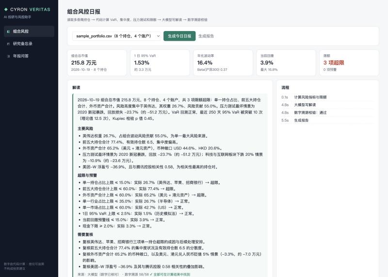 | 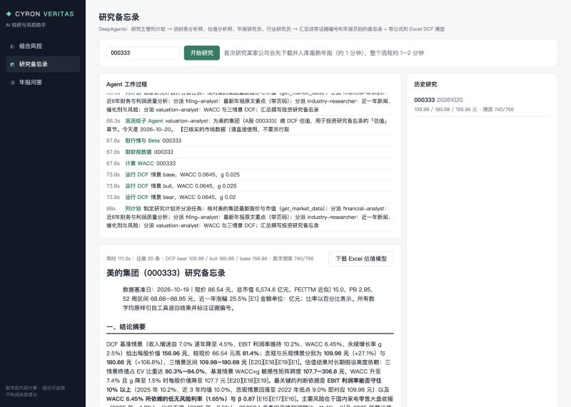 | 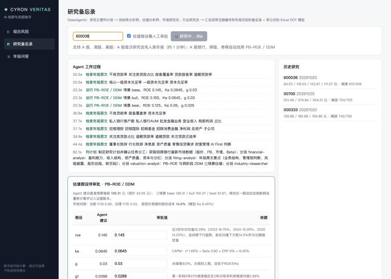 |
| **年报问答** | **业绩会纪要** | |
| 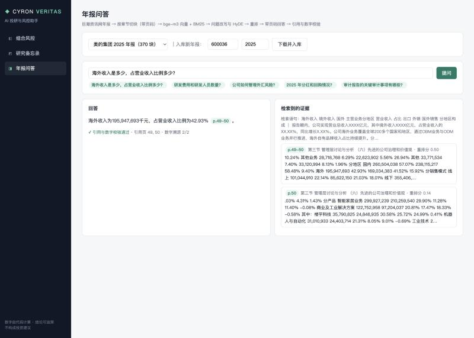 | 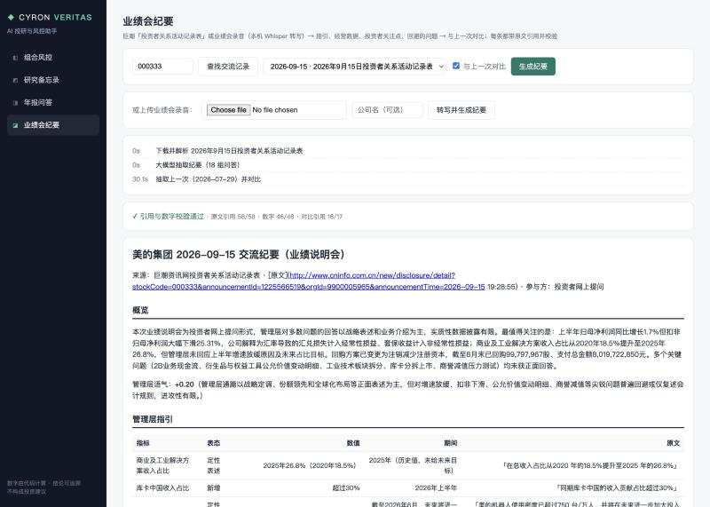 | |

## 资管中台：私募股票多头 + 量化指数增强 + PE / VC

下面的模块是研究员和风控岗的「单点工具」。资管中台把它们放回一家资管机构的真实流程里，三只模拟产品：股票多头（CV-VG1）、量化指数增强（CV-QE1）、成长期股权基金（CV-PE1）。股票多头的流程：
**托管估值表 → 净值入库与估值核对 → 每日风控与合同限额 → 业绩归因 → 股票池与投委会 → 交易前检查 → 投资者月报**。
设计文档见 [docs/PLATFORM_DESIGN.md](docs/PLATFORM_DESIGN.md)。

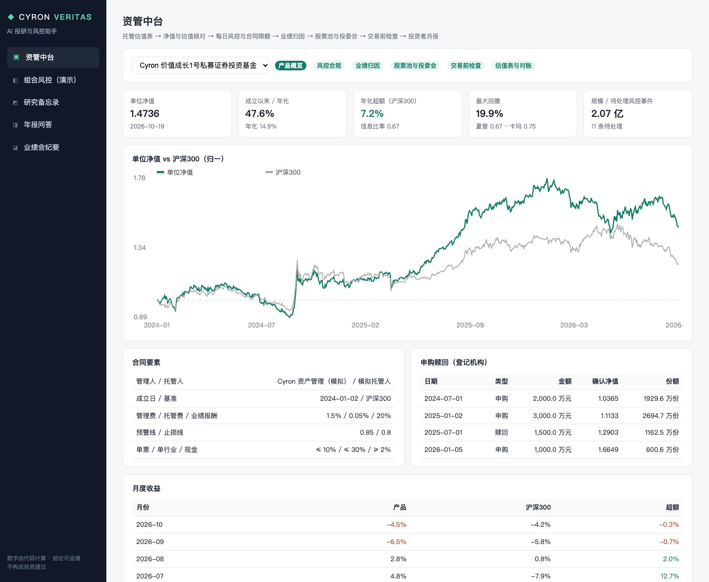

产品「Cyron 价值成长 1 号」（`config/products/CV-VG1.yaml`）：2024-01-02 成立，1 亿元起步，基准沪深300，管理费 1.5% / 托管费 0.05% / 业绩报酬 20%，
预警线 0.85、止损线 0.80，单票 ≤ 10%、单一申万一级行业 ≤ 30%、现金 ≥ 2%、5 日可变现 ≥ 80%，禁投池（000002）；期间有三次申购、一次赎回。

| 环节 | 做什么 | 代码 |
|---|---|---|
| 外部世界（模拟） | 用真实行情和公司行为逐日跑产品，产出托管估值表（Excel，科目代码 1002 / 1021 / 1102.01.01.xxxxxx / 1203 / 2206 / 2207 / 4001）、券商成交、登记机构申赎、投委会决议。中台其余部分**只读这些产出、不读模拟器内部状态**，接真实估值表时把模拟器换掉即可 | `fund/simulate.py` `fund/sheet.py` |
| 账务规则 | 不复权价估值；现金分红除息日记应收股利、次一交易日到账；送转只增股数不增成本；申赎按上一日净值确认；管理费托管费按自然日计提、季末支付；佣金、过户费、卖出印花税、滑点；一字涨跌停买不进卖不出；停牌沿用最近收盘价 | `fund/simulate.py` |
| 选股与投委会 | 只用已过披露截止日的报告期（无前视）；股票池按季度复核，现有持仓排名在前 2N 内保留（缓冲区压换手）；净利增速远高于营收增速的候选，投委会要求补充扣非数据、本期不入池 | `fund/simulate.py` |
| 估值核对 | 自估净值 = 昨日持仓 × 今日收盘 + 现金 + 应收 − 应付 − 当日计提；差异逐项解释（当日成交、申购赎回、除权除息），残差 > 净值 0.01% 标「待核查」 | `fund/ops.py` |
| 风控合规 | 每日快照（VaR / CVaR / Beta / 回撤 / 距预警线止损线 / 行业 / 流动性可变现天数）；合同限额三档（正常 / 预警 / 超限）入事件表，同一规则连续触发合并为一个区间，风控岗确认处理留痕；超限后次一交易日「风控整改」只卖不买 | `fund/risk.py` |
| 交易前检查 | 禁投池、核心池（未经投委会批准不得买入）、预警线下不得加仓、100 股整数倍、卖出不超持仓，再模拟成交后检查单票 / 行业 / 现金 | `fund/risk.py` |
| 业绩归因 | 净值指标（年化、超额、夏普、卡玛、跟踪误差、信息比率、月度胜率）；月度 Brinson（配置 / 选股 / 交互 / 其他），基准拼接误差单列；风格暴露（规模、价值、动量、波动、流动性、Beta 的截面 z 分数） | `fund/perf.py` |
| 投资者月报 | 数字全部由代码填进占位符，大模型只写「经理观点」；校验三件事：占位符都存在、占位符外没有数字、**定性判断方向与数字一致**（写「配置效应拖累」但配置效应为正会被打回重写）；HTML + PDF | `fund/report.py` |

模拟结果（2026-10-19）：单位净值 1.4736，成立以来 47.6%（沪深300 23.3%），年化超额 7.2%，最大回撤 19.9%，夏普 0.67；673 个交易日估值核对全部一致；
合同限额事件 53 天（合并后 11 个区间，主要是非银金融接近行业上限的预警）。
**这是按规则回放的模拟产品，不是策略业绩**：选股规则很朴素，没有做样本外检验；股票池加缓冲区之后收益从 32.9% 升到 47.6%，
这一步是为了让换手更接近真实，不是为了调收益，但同样是样本内的结果。

```bash
uv run veritas fund simulate CV-VG1     # 生成 674 张托管估值表、成交、申赎、投委会记录（约 10 秒；首次运行要先下载中证 800 行情，较慢）
uv run veritas fund backfill CV-VG1     # 估值表入库 → 估值核对 → 每日风控（约 20 秒）
uv run veritas fund daily CV-VG1 --date 2026-10-19
uv run veritas fund pretrade CV-VG1 --orders orders.json
uv run veritas fund perf CV-VG1
uv run veritas fund report CV-VG1 --month 2026-09   # 投资者月报
```

Brinson 的基准行业权重需要沪深300 **历史**成分权重。没有时用最新权重按个股总收益倒推，仍有幸存者偏差，月均近似误差约 0.8%（单列，不混进配置 / 选股效应）；
在 `.env` 里配置 `TUSHARE_TOKEN`（`index_weight` 接口，2000 积分）后自动改用历史成分权重。

### 量化指数增强：Cyron 量化增强 1 号（CV-QE1）

对标中证500，2024-02-01 成立、2 亿起步（`config/products/CV-QE1.yaml`）。合同条款：单票偏离 ≤ 2%、行业偏离 ≤ 3%、成分股 ≥ 股票资产 80%、跟踪误差目标 ≤ 6%。
和股票多头产品共用同一套账簿、托管估值表、估值核对、风控事件和 Web 页面（`fund/ledger.py` 是两只产品共用的逐日记账）。

| 环节 | 做什么 | 代码 |
|---|---|---|
| 因子库 | 11 个 alpha 因子（EP、BP、ROE、毛利率、现金流 / 利润、净利 / 营收增速、12-1 动量、1 月反转、低波、低换手）；月末收盘后算、次日收盘成交；基本面只用已过披露截止日的报告期；MAD 去极值 → 标准化 → 行业 + 市值中性化 | `quant/factors.py` |
| 因子检验 | 月度 IC / RankIC、ICIR、t 值、五分组多空、因子相关性；合成权重 = 最近 12 期 ICIR（负值置 0），**只用远期窗口已结束的 IC**（第 m − 1 期在 e_m 还不知道，测试里专门验证），所以合成因子的 IC 是样本外的；等权合成作对照 | `quant/research.py` |
| 风险模型 | 31 个申万一级行业 + 6 个风格（规模、Beta、动量、波动、价值、流动性）；逐日截面加权最小二乘（√流通市值）；因子协方差 EWMA 半衰期 90 日、特异方差 EWMA 60 日并向截面中位数收缩 | `quant/riskmodel.py` |
| 组合优化 | cvxpy + Clarabel：最大化 αᵀw − λ·主动风险 − 交易成本；α = IC × 特异波动 × z（Grinold）；单票 / 行业偏离、成分股下限、风格暴露（规模单独从严 ±0.10）、换手、事前跟踪误差约束；合同限额打 8 折留漂移空间；停牌股权重冻结；不可行时按顺序放宽并留痕 | `quant/optimizer.py` |
| 执行 | 目标股数在信号日固定，次日起每只股票每天成交 ≤ 当日成交量 10%，做不完次日继续；一字板、停牌不交易；冲击成本 = 5bp + 0.3 × 日波动 × √(成交量占比) | `quant/strategy.py` |
| 风控反馈 | 每次调仓用「事后 60 日跟踪误差 / 最近 3 次事前跟踪误差」放大风险模型（偏差校正，截断到 [1, 2.5]）；事后跟踪误差超过目标 90% 时收紧事前上限 | `quant/strategy.py` |
| 超额分解 | 产品 − 指数逐日**精确相加**拆成：费用与交易成本、行业、风格（逐个因子）、选股（特异）、现金拖累、幸存者偏差、成分股股息；风险模型偏差检验（事前 vs 事后跟踪误差） | `quant/attribution.py` |

| 超额归因 | 因子研究 |
|---|---|
| 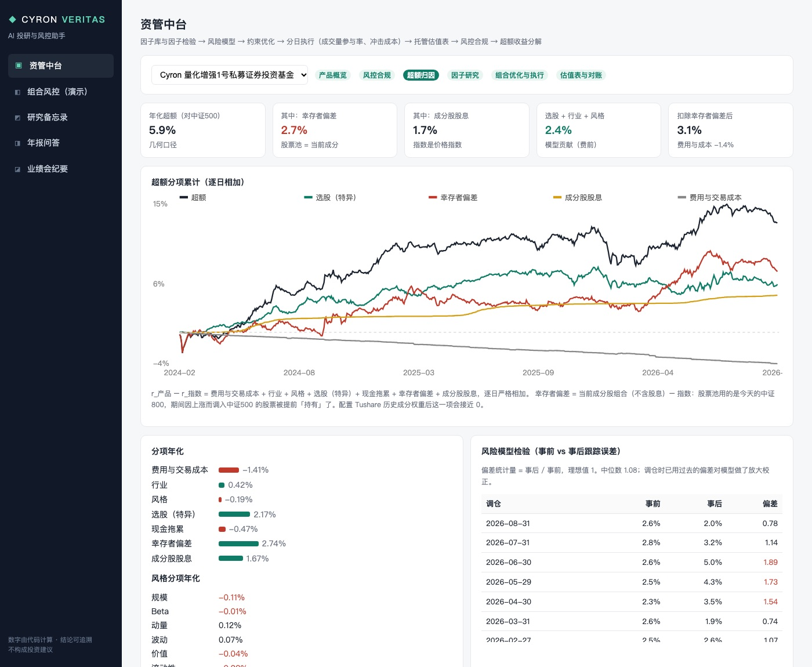 | 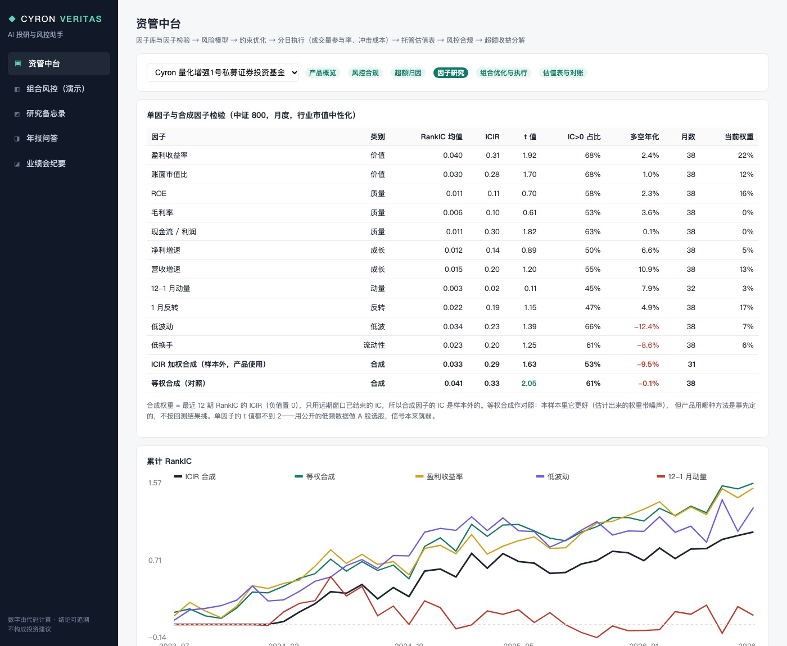 |

**结果（2024-02-01 至 2026-10-19，模拟）**：单位净值 1.6504，成立以来 65.2%，中证500 45.4%；年化超额 5.9%、跟踪误差 3.4%、信息比率 1.62；
33 次调仓全部求解成功，执行完成率 99.8%–100%，平均冲击成本 8.2 bp（7–11 bp）；651 个交易日估值核对全部一致。

**但这 5.9% 里大半不是本事**（超额分解，年化）：

| 来源 | 年化 | 说明 |
|---|---|---|
| 幸存者偏差 | +2.7% | 股票池是**今天**的中证 800，期间因上涨被调入中证500 的股票被提前「持有」了；被动持有当前成分股本身就跑赢指数 |
| 成分股股息 | +1.7% | 中证500 是价格指数，不含分红 |
| 选股（特异收益） | +2.2% | 模型真正的贡献 |
| 行业 / 风格 | +0.4% / −0.2% | 偏离被约束得很紧，基本不靠行业和风格 |
| 费用与交易成本 | −1.4% | 管理费 1%、托管费、佣金印花税、冲击成本 |
| 现金拖累 | −0.5% | 2% 现金 |

扣掉幸存者偏差后年化超额约 3.1%（其中 1.7% 是股息）。因子本身很弱：11 个单因子 RankIC 的 t 值都不到 2；
ICIR 加权合成样本外 RankIC 0.033（t = 1.63），**不如不估计权重的等权合成**（0.041，t = 2.05）——估计出来的权重带噪声，这是常见结论。
产品用 ICIR 加权是事先定的，没有按回测结果改（`strategy.alpha: equal` 可以切换）。
风险模型系统性低估跟踪误差（未校正时事后 / 事前约 1.5–2 倍），加了偏差校正后中位数 1.08。

```bash
uv run veritas quant research           # 因子面板、IC、分组、合成（约 10 秒，读已缓存的行情）
uv run veritas quant riskmodel          # 逐日因子收益与残差
uv run veritas fund simulate CV-QE1     # 按类型自动走量化策略：月末优化 + 分日执行 + 估值表（约 30 秒）
uv run veritas fund backfill CV-QE1     # 估值表入库 → 核对 → 每日风控
uv run veritas quant attribution CV-QE1 # 超额分解 + 风险模型检验
```

### PE / VC：Cyron 成长股权投资基金 1 期（CV-PE1）

认缴 8 亿、2020-01 首次交割、投资期 3 年 + 退出期 4 年；管理费投资期按认缴额 2%、退出期按未退出成本 2%（半年预收）；
欧式整体分配：返还实缴 → 8% 复利门槛 → GP 100% 追补 → 80/20（`config/products/CV-PE1.yaml`）。

**项目是真实的科创板公司，交易条款来自招股说明书**：基金「跟投」了这些公司 2020 年真实发生过的融资轮次（价格、估值、投资方、锁定承诺都是原文），
上市后按真实行情、真实分红送转减持。跟投行为、LP、管线里的投决过程是模拟的；另有两个**明确标注的虚构未上市项目**（一个核销、一个对赌回购只收回七成），
因为只投后来上市成功的公司是后见之明。

| 环节 | 做什么 | 代码 |
|---|---|---|
| 尽调 Agent | 巨潮下载招股说明书 → 按页抽文本 → jieba + BM25 检索 → 按清单结构化抽取（股本演变与历次融资、发行条款、股东锁定承诺、三年财务、客户集中度、主要风险、主营业务）；**每个数字核对引用页**（认万元 / 元、万股 / 股两种写法，表格跨页允许相邻页），核对不通过的字段交分析师复核；锁定承诺按股东逐家找（同一轮的投资人承诺可能不同） | `pe/prospectus.py` `pe/dd.py` |
| 交易条款 | 大模型只「抄」，代码算：投后估值（原文投后 / 投前 + 新增资金 / 价格 × 股本）、持股比例、后续增资稀释（同一次增资的两档价格不算稀释）、发行前总股本 → 持股数 → 每股成本；**原文估值与价格 × 股本交叉校验**；员工持股平台、代持还原这类轮次外部基金参与不了，直接拦截；解禁日 = max(上市 + 12 个月法定底线, 股东承诺) | `pe/deals.py` |
| 基金运行 | 逐日：缴款通知（提前 10 天，按认缴比例）→ 交割 → 上市转股 → 分红送转 → 解禁后 6 个月分批减持（日成交量 ≤ 10%、90 天 ≤ 总股本 1%；低于成本暂缓、每季度投委会复议；成立满 6 年强制退出）→ 季度分配 → 项目全部退出后清算 | `pe/fund.py` |
| 估值 | 未上市：交割 12 个月内最近融资价格，之后成本 × 申万行业指数（市场法校准）；上市限售：收盘价 ×（1 − AAP 流动性折扣），LoMD = N(σ√T/2) − N(−σ√T/2)（中基协流通受限股票估值指引）；已解禁：收盘价 | `pe/fund.py` `pe/metrics.py` |
| 分配与指标 | 瀑布逐笔计算并可做假设清算（LP 资本账户净值、应计业绩报酬）；GP 1% 认缴不收费不计提业绩报酬；TVPI / DPI / RVPI、净 IRR（XIRR）、项目毛 IRR / MOIC、Kaplan-Schoar PME（沪深300、中证500） | `pe/waterfall.py` `pe/metrics.py` |
| LP 季报 | 资本账户、组合估值、本季度缴款分配退出、GP 观点；占位符 + 方向词校验之外，还拦截两类口径错误：「分配摊薄了 TVPI」（分配不改变 TVPI）、「减少 −3,315 万元」这种双重否定 | `pe/report.py` |
| 后见之明压力测试 | 假设每个真实项目只有 p 的概率按实际路径上市，否则按未上市项目的典型结局（假设比例：40% 核销、40% 回购约七成、20% 并购 1.2x），1 万次模拟看组合毛回报倍数分布 | `pe/stress.py` |

| 基金概览 | 项目估值与交易条款 | 尽调报告 |
|---|---|---|
| 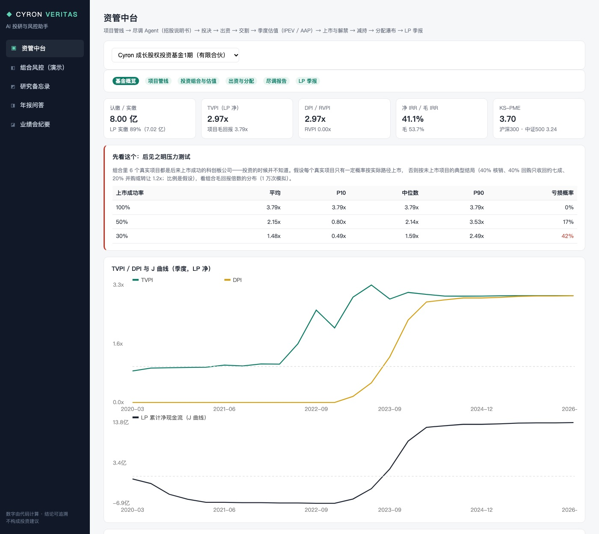 | 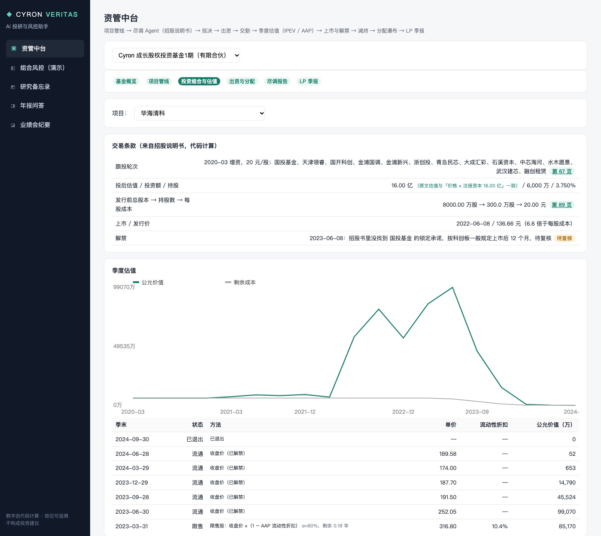 | 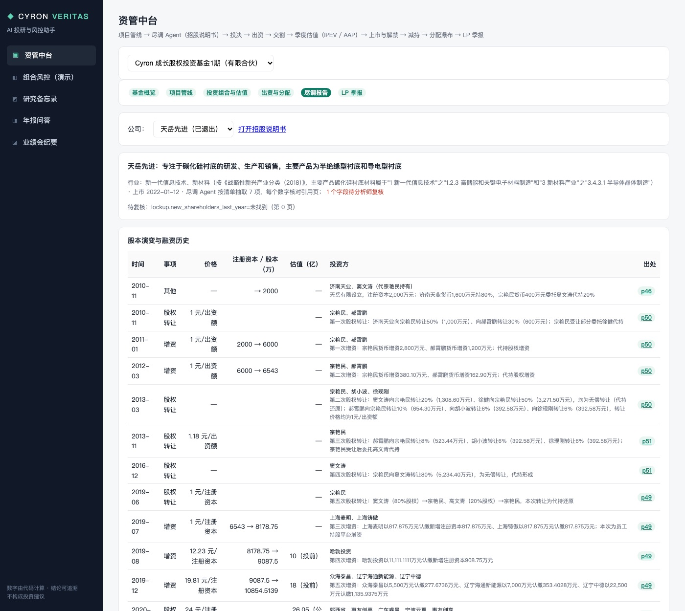 |

**尽调 Agent 实测**（14 家 2022 年上市的科创板公司，约 2 分钟）：抽出 4–22 个股本事件；核对后待复核的字段集中在
「金额单位写法不同」「估值引用了另一页」这类，例如亚虹医药 38.6 亿投后估值引用了第 75 页、原文其实在第 84 页——交叉校验（236.98 元 × 1,628.82 万 = 38.6 亿）确认数字没错。
人工抽查发现并修掉的问题：翱捷科技 5.55 元 / 股那一轮是**员工持股平台增资**（外部基金进不去），源杰科技同一次增资有机构价 66.56 和员工平台价 22.19 两档，
三家公司的领投方锁定承诺按名字找不到（简称不一致），按法定 12 个月处理并标「待复核」。

**结果**：6 个真实项目——华海清科 15.3x、海光信息 5.7x、源杰科技 4.3x、天岳先进 3.0x、华大智造 1.35x（解禁后跌破成本，投委会 5 次复议后才卖完）、
亚虹医药 1.19x；虚构项目 0x 和 0.87x。基金 2026-03 清算：**LP 净 TVPI 2.97x、净 IRR 41%、KS-PME 3.70**；GP 业绩报酬 3.45 亿，正好是全部利润 17.24 亿的 20%（瀑布对账）。

**这个业绩不能当真**：6 个真实项目都是事后挑的「上市成功」公司。压力测试：上市成功率 50% 时组合毛回报平均 2.15x（亏损概率 17%），
30% 时平均 1.48x（亏损概率 42%）。2020 年投科创板 pre-IPO、2022 年上市高估值发行，这一段确实是人民币基金回报最好的窗口之一，但只有事后才知道哪些公司能上市。

```bash
uv run veritas pe dd 688234,688120     # 尽调 Agent：下载招股书、抽取、核对（每家约 30 秒，需要 LLM_API_KEY）
uv run veritas pe run CV-PE1           # 基金逐日运行到最新交易日
uv run veritas pe report CV-PE1 --quarter 2023Q3 --lp LP02   # LP 季报
uv run veritas pe stress CV-PE1        # 后见之明压力测试
```

## 模块

### 1. 组合风控日报（LangGraph 固定流程）

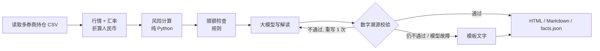

| 计算内容 | 方法 |
|---|---|
| 敞口 | 行业、市场、币种；集中度（前一 / 前五、HHI、有效持仓数） |
| 波动与相关性 | 年化波动率、Beta（沪深300）、相关性最高的持仓对 |
| VaR / CVaR | 历史模拟法（95% / 99%）、参数法（正态），按「当前持仓回放」近 500 个交易日 |
| 风险贡献 | 各持仓占组合波动比例 w·(Σw) / w'Σw |
| 压力测试 | 历史情景（2020 新冠、2022 港股中概、2024 年初 A 股）+ 假设情景（市场、汇率、板块冲击） |
| 模型回测 | 滚动 250 天 VaR 回测 + Kupiec 失败比例检验 |
| 限额 | `config/limits.yaml`：单一持仓、前五大、行业、市场、外币、VaR、回撤、现金下限；超限时列出全部超限标的 |

### 2. 年报 RAG（巨潮资讯网年报 → 带页码问答）

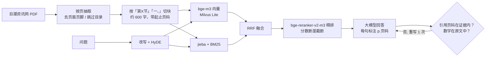

- **切块**：PDF 硬换行只在「正文被折行」时拼接（上一行接近满行且不以句末标点结尾），表格单元格保留换行，避免两列数字粘成一个数。
- **存储**：Milvus Lite（本地单文件，不需要 Docker）+ 切块 JSON；同一份 PDF（sha256 + 解析器版本）不重复入库。
- **校验**：回答里引用的页码必须落在检索到的证据范围内；回答里的数字必须出现在证据原文里；不通过带着错误重写一次。

**评测**（[eval/annual_report_qa.json](eval/annual_report_qa.json)：美的集团、宁德时代、招商银行 2025 年报，40 题，分数字类 / 语义类；
答案页由原文锚点自动定位；[完整结果](eval/results.md)）

| 检索方案 | Hit@1 | Hit@3 | Hit@5 | MRR | Hit@5·招商银行 | Hit@5·语义题 |
|---|---|---|---|---|---|---|
| 仅向量（bge-m3） | 50% | 52% | 68% | 0.543 | 20% | 78% |
| 仅 BM25 | 35% | 75% | 90% | 0.576 | 80% | 89% |
| 混合（RRF） | 50% | 78% | 80% | 0.630 | 60% | 78% |
| **混合 + 重排** | **62%** | **88%** | **95%** | **0.747** | **90%** | **100%** |
| 改写 + HyDE + 混合 + 重排 | 62% | 88% | 92% | 0.736 | 80% | 100% |

端到端：**答案正确率 100%（40/40），引用与数字校验通过率 100%**，平均 6.2 秒/题。

两点发现（如实记录）：
- **银行年报几乎全是数字表格，纯向量检索在招行上 Hit@5 只有 20%**（「不良贷款率 0.94%」这类内容在向量空间里区分度很低），BM25 的精确匹配是关键，混合 + 重排后 90%。
- 问题改写 + HyDE 没有带来提升（Hit@5 反而 92% vs 95%，多花约 1.4 秒/题）；当前默认仍保留，后续按题型开关。

### 3. 研究 Agent（DeepAgents）+ 估值假设人工审批

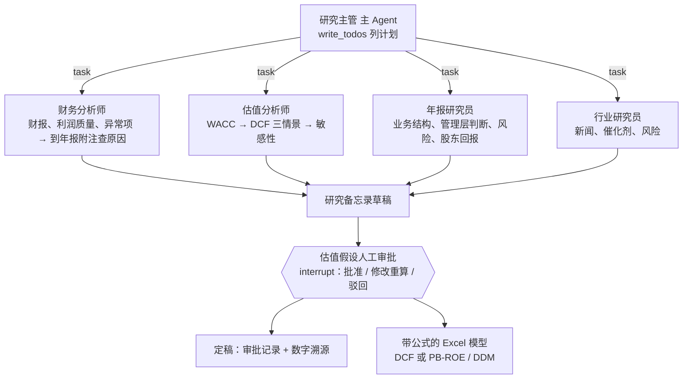

- **工具全部只读、全部是代码计算**：财报取数与比率、市场数据与 Beta、CAPM WACC、DCF（FCFF 法）、PB-ROE / DDM、年报检索、新闻搜索；每次调用记进证据账本，返回证据编号，备忘录引用编号和年报页码。
- **三个市场**：A 股（东方财富三表）、港股（「经营溢利」作 EBIT；报表币种按「市值 ÷ 市净率 ÷ 每股净资产」反推——腾讯是人民币报表、港元股价）、美股（美元报告公司）；
  无风险利率 A 股用中国 10 年国债，港股 / 美股用美国 10 年国债；每股价值换算成股价币种。港美股暂无年报检索。
- **金融企业**（A 股银行、保险、券商）不用 DCF，改用 **PB-ROE**（合理 P/B =（ROE − g）/（Ke − g），普通股净资产扣除优先股和永续债）和**两阶段 DDM**；
  工具同时输出「按现价倒推的市场隐含股权成本」，和模型 Ke 差距大时 Agent 必须解释分歧来源。
- **口径**：营运资本只用经营性科目（应收、票据、存货、合同资产 − 应付、合同负债、薪酬、税费）；计入其他科目的定期存款 / 理财不自动算现金，
  估值分析师到年报附注里核实后才能填 `extra_cash`，且必须写明科目、金额和页码。
- **估值假设人工审批**：外层 LangGraph 流程「研究 → 审批（`interrupt`）→ 定稿」。Agent 跑完后暂停，把基准假设、依据和市场对照交给分析师：
  批准 / 修改后重算 / 驳回；修改会用新假设重新计算并记入证据账本，审批人、意见和前后对比写进备忘录，Excel 按审批后的假设生成，驳回则不出 Excel。
  （审批放在外层图而不是 DeepAgents 内部：子 Agent 在工具调用里嵌套运行，在那里暂停恢复不稳定。）
- **Excel 模型是真公式**（蓝色输入 / 黑色公式）：DCF 模型和 PB-ROE / DDM 模型都是；改假设页，估值和敏感性自动重算；测试里用 `formulas` 库重算工作簿，和 Python 引擎一致到小数点后 9 位。
- **估值前先做利润质量审查**：杜邦三步 / 五步、Piotroski F 分（9 项）、Altman Z（制造业原版与 Z''）、Beneish M 分（8 变量）、应计比率，
  由代码按规则给出 **A–D 利润可信度评级**（Beneish > −1.78 扣 2 级；应计比率 > 10%、经营现金流 / 净利 < 0.8、Piotroski ≤ 3 各扣 1 级）；
  C 级结论只能「观望」，D 级不能给正面结论。评级不交给大模型判断。
- **反向 DCF（预期差）**：其他假设不变，求出让每股价值等于现价的收入增速，和我们的假设、历史增速放进同一张「预期差表」。
- **备忘录九章结构**（参考 [equity-research-skill](https://github.com/rollingSirius/equity-research-skill) 的机构研究框架）：一页摘要（结论框 + 预期差表）、
  公司与业务、竞争格局、管理层与资本配置、财务分析与利润质量审查、估值、催化剂与风险、**反方观点与事前验尸**、待核实问题；章节缺失时如实标注。
- **护栏**：模型调用、工具调用、派活次数都有上限；假设不合理（如永续增长率 ≥ WACC、g ≥ ROE）工具直接拒绝；
  模型推理加锁（MPS 不支持多线程同时提交计算，多个子 Agent 并行检索曾导致 Metal 断言崩溃）。
- **为什么风控用 LangGraph、研究用 DeepAgents**：日报步骤固定、要求稳定可复核 → 固定流程；研究是开放任务（查什么、查几轮、发现异常要不要追问）→ 让 Agent 自己列计划、派子 Agent。

### 4. 业绩会纪要（投资者关系记录 / 录音 → 指引、回避的问题、环比变化）

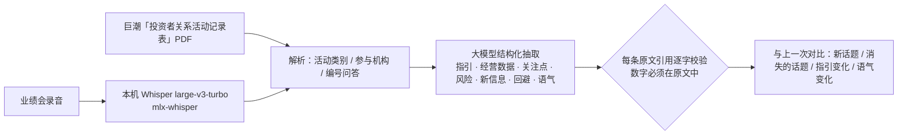

- **研究员最需要的不是「这次说了什么」，而是「哪里变了、哪些问题没正面回答」**：抽取结果单列「回避或未正面回答」，对比单列「指引变化」。
- **每条结论带原文引用**：引用去掉空白和标点后必须是原文子串，否则在纪要里标 ⚠️；概览和数值里的数字必须出现在原文中。
- **实测**（美的集团 2026-09-15 业绩说明会，18 组网上问答，对比 2026-07-29 路演）：69 条引用全部通过、63 个数字全部可溯源、22 条对比变化引用全部通过；
  纪要指出「B 端增速放缓原因、权益工具公允价值变动 26.77 亿元的来源、库卡分拆上市」等问题管理层均未正面回答。
- **录音**：本机 mlx-whisper（30 秒音频约 9 秒转写，「百分之十二」自动规范为「12%」）；没有说话人分离，问答由大模型按语义切分（下一步：FunASR 说话人分离、SenseVoice 支持粤语）。

### 5. MCP Server（Claude Desktop / Cursor 直接调用）

`uv run veritas mcp`（stdio）暴露 10 个工具：`portfolio_risk`、`company_financials`、`market_snapshot`、`dcf_valuation`、
`financial_institution_valuation`、`annual_report_search`、`annual_report_qa`、`ingest_annual_report`、`investor_relations_records`、`earnings_call_summary`。
除年报入库外全部标注为只读；数字仍由代码计算，客户端的大模型只负责提问和组织回答。Claude Desktop 配置：

```json
{"mcpServers": {"cyron-veritas": {"command": "uv", "args": ["--directory", "/path/to/cyron-veritas", "run", "veritas", "mcp"]}}}
```

### 6. Web 界面（FastAPI + Vue 3）

四个页面：组合风控（选持仓 → 生成日报，显示流程与校验结果）、研究备忘录（实时显示 Agent 在做什么、估值假设审批表单、下载 Excel 模型）、
年报问答（入库新年报、流式回答、点页码看原文 / 打开 PDF 对应页）、业绩会纪要（选交流记录或上传录音，生成纪要并与上一次对比）。长任务在后台线程运行，前端通过 SSE 订阅进度。

## 与业界开源库交叉验证

自研的估值、风险和利润质量计算，用同样的输入和成熟开源库逐项对答案（`tests/test_cross_validation.py`，10 项全部通过）：

| 自研实现 | 对照库 | 结果 |
|---|---|---|
| DCF（FCFF） | [FinanceToolkit](https://github.com/JerBouma/FinanceToolkit) `get_intrinsic_value` | 一致（相对误差 < 1e-9） |
| 两阶段 DDM | FinanceToolkit `get_two_stage_dividend_discount_model` | 一致 |
| PB-ROE | FinanceToolkit 戈登增长模型 | 一致（约定差异：PB-ROE 用当期净资产 × ROE 作下一年利润，相差 (1+g)，测试中写明） |
| CAPM 股权成本 | FinanceToolkit `get_capital_asset_pricing_model` | 一致 |
| 杜邦三步 / 五步、Altman Z、Piotroski 各项 | FinanceToolkit `dupont_model` / `altman_model` / `piotroski_model` | 一致 |
| VaR、CVaR、最大回撤、年化波动率、Beta | [empyrical](https://github.com/stefan-jansen/empyrical-reloaded) | 一致 |
| 反向 DCF | 自洽性：用某增速算出价格，再反推回同一增速 | 一致 |

## 样例结果（2026-10-20，真实模型 DeepSeek）

**风控日报**（示例持仓，4 个券商账户、8 只股票 + 现金）：总市值 215.8 万元，1 日 95% VaR 1.53%（约 3.3 万元）；
3 项超限（英伟达、苹果、招商银行单一持仓 > 15%，前五大 77.4%，外币资产 65.2%）；VaR 回测 250 天突破 10 次（理论 12.5 次），Kupiec p = 0.45；
解读中的数字全部可溯源。→ [HTML 报告](docs/samples/risk_report.html)

**美的集团（000333）研究备忘录**：111 秒，4 个子 Agent，约 14 万 token；DCF 三情景每股 110.0 / 157.0 / 180.7 元（现价 86.54 元）；
备忘录 756 个数字中 740 个可在证据账本中找到（97.9%，未溯源的多为模型自行计算的差值）。
财务分析师发现 2025 年营运资本占收入比从 −9.6% 跳到 +8.1%，**自己到年报附注里查到原因**：
一年内到期的固定收益类产品从 486 亿元增至 1,554 亿元（年报 p.208-209，计入流动资产但不是货币资金），并如实注明「年报中未找到整体说明」；
同时指出终值占 EV 80% 以上、近两年周线 Beta 的 R² 仅 0.003（改用 5 年月线），结论对 WACC 和永续增长率高度敏感。
→ [备忘录](docs/samples/000333_memo.md) · [Excel 模型](docs/samples/000333_DCF模型.xlsx)

**招商银行（600036，PB-ROE / DDM + 人工审批）**：Agent 建议长期 ROE 14.5%（近 3 年均值 15.28%，但 2022→2025 从 17.7% 降到 14.0%，下调）、
Ke 用 CAPM 6.45%，基准每股 136.31 元；审批卡片显示当前 P/B 0.99、模型合理 P/B 3.33、**按现价倒推的市场隐含 Ke 14.6%**。
分析师把 Ke 改为 10% 后重算：PB-ROE 71.36 元、DDM 57.86 元，平均 **64.61 元**；审批记录写入备忘录第七节。
→ [备忘录](docs/samples/600036_memo.md) · [Excel 模型](docs/samples/600036_估值模型.xlsx)

**腾讯控股（00700，港股）**：识别出人民币报表 / 港元股价（汇率 1.1677），DCF 基准每股 304 港元（现价 417.8 港元）；
Agent 抓住的关键变量是 AI 资本开支（单季同比 +176%，自由现金流转负）。

## 运行

```bash
uv sync
cp .env.example .env              # 填 LLM_API_KEY（DeepSeek 或任何 OpenAI 兼容接口），新闻搜索需要 TAVILY_API_KEY
cd frontend && npm install && npx vite build && cd ..
uv run veritas serve              # Web 界面 http://127.0.0.1:8100

uv run veritas risk               # 命令行生成风控日报（默认 portfolio/sample_portfolio.csv；真实持仓用 portfolio/private_*.csv，已 gitignore）
uv run veritas ingest 000333 2025 # 下载并入库年报（约 1 分钟）
uv run veritas research 000333    # 研究 Agent（也支持 600036 银行、00700 港股、AAPL 美股）
uv run veritas research 600036 --review   # 估值假设在终端里人工审批
uv run veritas calls 000333       # 最新一次投资者交流纪要，并与上一次对比
uv run veritas transcribe call.m4a --company 某公司   # 录音 → 纪要
uv run veritas mcp                # MCP Server（stdio）
uv run python -m cyron_veritas.rag.evaluate --qa   # 年报问答评测
uv run pytest -q                  # 74 个测试（含与 FinanceToolkit / empyrical 的交叉验证、资管中台账务与风控规则、量化无前视与优化器约束、PE 瀑布与交易条款）
```

向量和重排模型默认读 `~/models/bge-m3`、`~/models/bge-reranker-v2-m3`，不存在则从 HuggingFace 下载（`EMBED_MODEL` / `RERANK_MODEL` 可覆盖）。
在 Apple Silicon 上自动用 MPS。

## 目录

```
src/cyron_veritas/
  data/        market.py（行情、汇率、国债收益率，按天缓存）  financials.py（A 股三表 → 统一口径）
  risk/        metrics.py（纯函数）  portfolio.py  limits.py  report_graph.py（LangGraph）
  valuation/   dcf.py（FCFF、WACC、敏感性、反向 DCF）  fin.py（PB-ROE、DDM）  quality.py（杜邦、Piotroski、Altman、Beneish、A–D 评级）  excel.py
  rag/         filings.py（下载、解析、切块）  index.py（Milvus Lite + BM25 + 重排）  qa.py（带页码问答与校验）  evaluate.py
  research/    tools.py（工具 + 证据账本）  agent.py（DeepAgents 主 / 子 Agent + 外层审批流程）
  calls/       source.py（记录表解析、Whisper 转写）  analyze.py（抽取、引用校验、对比）  run.py
  mcp_server.py  MCP Server（10 个工具）
  web/         server.py（FastAPI、后台任务、SSE）
  report/      charts.py  render.py  templates/
  fund/        资管中台：marketdata.py  ledger.py（两只产品共用的逐日记账）  simulate.py（股票多头产品）  sheet.py（估值表读写）  ops.py（估值核对）
               risk.py（风控、限额事件、交易前检查）  perf.py（净值指标、Brinson、风格）  report.py（投资者月报）  db.py
  quant/       factors.py  research.py（IC、合成）  riskmodel.py  optimizer.py（cvxpy）  strategy.py（指增产品）  attribution.py（超额分解）
  pe/          prospectus.py（招股书）  dd.py（尽调 Agent）  deals.py（交易条款）  fund.py（基金运行）  waterfall.py  metrics.py（IRR / PME / AAP）  stress.py  report.py（LP 季报）
  verify.py    数字溯源与措辞检查
frontend/      Vue 3 + Vite（资管中台 / 风控 / 研究 / 年报问答 / 业绩会纪要）
config/products/  产品合同要素（YAML）
eval/          年报问答评测集与结果
```

## 数据与口径

数据来自 [akshare](https://github.com/akfamily/akshare)（东方财富、新浪财经、中国银行外汇中间价、国债收益率）和巨潮资讯网年报，均为公开数据。
EBIT = 利润总额 + 利息费用 − 利息收入；有息负债含租赁负债；基期营运资本按假设比例标准化。口径细节见各模块顶部注释。

## 已知局限

- 研究备忘录是长文本，仍用「数字能在证据账本中找到」做溯源（九章结构下约 94%：预期差和事前验尸里 Agent 自己做了加减运算），
  没有像风控日报那样做到结构化引用；溯源也检查不出「算式写错」（实测出现过一次括号里的加减式与结果不符）。
- 类现金资产的计入：Agent 会到年报附注核实，但实测仍可能把全部候选金额（而非附注确认的部分）填进 extra_cash，需要人工审批把关。
- 港股 / 美股：没有年报原文检索；美股只支持美元报告公司（中概 ADR 的人民币报表和 ADS 比例未处理）；港美股金融企业暂不支持。
- 银行估值没有用到不良率、拨备覆盖率等资产质量指标的量化调整（Agent 从年报中引用，但不进入模型）；CAPM 在当前低利率下给出的 Ke 偏低，需要人工审批把关。
- 审批流程的检查点存在内存（MemorySaver），服务重启后未完成的审批会丢失；生产环境应换成 SQLite / Postgres checkpointer。
- 年报评测集 40 题、3 份年报，规模仍小。
- 量化：股票池是当前中证 800 成分，有幸存者偏差（已量化并单列，约年化 2.7%）；日线从 2023-01 开始，因子只有约 3 年样本；
  基本面用业绩快报的年初至今累计值年化，不是 TTM；没有股指期货对冲、没有日内 / 高频因子；冲击成本模型是经验公式，没有用真实成交回报校准。
- 腾讯日线接口的成交量单位因股票而异（股 / 手 / 股×100），已按成交额统一换算成股（`marketdata._volume_in_shares`）；修正前流动性指标偏大约一万倍。
- PE：组合是事后挑的上市成功公司（后见之明，压力测试单列）；只覆盖科创板，招股书版式不同的板块没测；未上市阶段的估值只用行业指数校准，没有用可比公司倍数；
  减持规则只实现了「90 天 1% 集中竞价」和成交量上限，没有实现大宗交易、询价转让和 2023 年以后的破发 / 破净限制减持新规；后续出资（follow-on）、可循环投资、分级 LP 没有做。
- 资管中台的估值表由模拟器生成，估值核对的残差天然为 0；「待核查」路径只在测试里用篡改的估值表验证过（`tests/test_fund.py`）。
- 风控整改逻辑在本次回放里没有被触发（没有出现超限的行业 / 单票），只有单元测试覆盖。
- 业绩报酬只写在合同要素里，没有按高水位计提；份额登记没有区分投资者（没有分投资者的业绩报酬和持有期）。

## 免责声明

本项目仅用于学习和研究，不构成任何投资建议。示例持仓为虚构。
